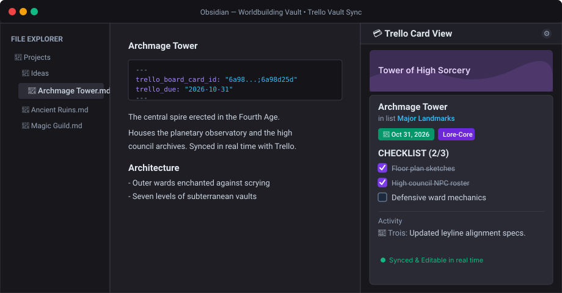

# Trello Vault Sync

Two-way Trello synchronization, an interactive card sidebar, link auditing, and safe conflict handling for Obsidian.


Keep your Obsidian notes and Trello cards perfectly aligned. View and edit cards directly in Obsidian's sidebar, synchronize notes individually or across entire project folders, and rest easy with zero-data-loss safety guarantees, visual conflict resolution, and 100% undoable history.



---

## First 10 minutes

Get up and running in 6 simple steps. **Default settings work out of the box** — you don't need to tweak complex configurations to start syncing.

1. **Install the plugin**: In Obsidian, open **Settings → Community plugins → Browse**, search for **"Trello Vault Sync"**, install and enable it.
2. **Connect your Trello board**:
   - Open [trello.com/app-key](https://trello.com/app-key) in your browser.
   - Copy your **API Key**.
   - Click the authorization link on the same page to generate and copy your **Token**.
   - In Obsidian, open **Settings → Trello Vault Sync**, paste your Key and Token, then type your board's name in the **Board id** search field. Click **"Test connection"** to confirm access.
3. **Link your first note**: Open any note in your vault, open the command palette (`Ctrl+P` or `Cmd+P`), and run **"Link this note to a card I choose"** (or **"Link this note to the card with the same name"** for automatic title matching).
4. **Run your first sync**: Run **"Sync this note with its card"**. The newest edit automatically updates the other side. *(Tip: Turn on Dry run in the sidebar anytime you want to preview a sync with zero writes).*
5. **Open the Card View**: Run **"Open the card view"** to open the interactive side panel in Obsidian's right sidebar. You can inspect card covers, toggle checklist items, adjust due dates, add comments, or edit descriptions live.
6. **(Optional) Sync entire folders**: Under **Settings → Trello list ↔ folder**, pair any vault folder with a Trello list to reconcile all project notes in one click with **"Sync one folder with its list"**.

---

## The 5 commands you need to know

While Trello Vault Sync includes over 30 commands for specialized batch, audit, and recovery operations, everyday work only relies on these five:

1. **Open the card view** — Open the interactive sidebar panel showing the open note's Trello card.
2. **Sync this note with its card** — Reconcile the active note with its card (newest timestamp wins).
3. **Link this note to a card I choose** — Search your Trello board by name and link the selected card to your note.
4. **Sync one folder with its list** — Reconcile all notes in a folder with their corresponding Trello list in a single pass.
5. **Undo the last sync** — Revert every write made by the most recent sync run with one click.

*All other commands (vault-wide sweeps, orphan link audits, batch note/card creation, and change-log exports) remain available in the command palette and sidebar when you need advanced workflows.*

---

## Interactive Card View

**"Open the card view"** opens an interactive panel in Obsidian's right sidebar that follows your open note:

- **Follows active note**: Automatically updates when you switch notes, displaying the linked card's cover, title, list, due date, labels, assigned members, description, checklists, attachments, custom fields, and comments.
- **In-place live editing**: Toggle checklist tasks, update due dates, edit descriptions, add comments, or archive cards directly inside Obsidian.
- **Minimal API footprint**: Exactly one request per card, cached for a configurable duration. No background requests when the sidebar is hidden or when viewing unlinked notes.
- **Per-card customization**: Click the gear icon (`⚙`) in the header to choose which sections (checklists, comments, custom fields, attachments) are visible on that specific card.

---

## Safety & Peace of mind

Syncing between two systems shouldn't risk your notes. Trello Vault Sync is built with strict safety invariants:

- **100% Undoable History**: Every sync run (active note, folder, or vault-wide) is recorded. The **"Undo the last sync"** command can revert vault writes and matching Trello writes.
- **Visual Conflict Arbitration**: If both a note and its card changed since the last sync, the plugin flags a conflict and opens a side-by-side comparison modal so you can inspect differences and choose the winner.
- **Timestamp Preservation (`mtime`)**: Note cleanups and non-content metadata updates preserve the file's original modification date, preventing false sync loops or accidental overwrites.
- **Non-Destructive Trashing**: The plugin never permanently deletes local notes; deleted notes are always moved safely to Obsidian's configured Trash (`.trash` or system trash).
- **In-Stream Note Cleanup**: When you turn off a feature toggle in settings (e.g. Due dates or Card covers), the plugin automatically prunes safe stale frontmatter keys in-stream during subsequent syncs with **0 extra Trello API requests**, leaving user content strictly intact.

---

## Features & Command Reference

Every command below is available both from the right sidebar panel and the command palette.

### Active note

| Command | What it does |
| --- | --- |
| Sync this note with its card | Reconcile the open note with its linked Trello card, in whichever direction the newest change points. |
| Update this note from its card | Overwrite the open note with the linked card's current content. |
| Update the card from this note | Overwrite the linked Trello card with the open note's current content. |
| Overwrite this note with its card | Pull from the linked card regardless of which side changed more recently. |
| Overwrite the card with this note | Push to the linked card regardless of which side changed more recently. |
| Link this note to the card with the same name | Find the best-matching Trello card by title and link it to the open note. |
| Link this note to a card I choose | Search Trello cards by name and link the one you pick to the open note. |
| Unlink this note from its card | Remove the Trello properties from the open note. The card and the note's text are left untouched. |
| Compare this note and its card side by side | Show the note and its card side by side when both changed, and choose which one wins. |
| Open the card view | Show the open note's Trello card in a side panel: read it, and edit it if editing is on. |
| Create a card from this note | Create a new Trello card from the open note and link it back. |
| Undo the last sync of this note | Revert the most recent sync write made to the open note. |

### Folders

| Command | What it does |
| --- | --- |
| Sync one folder with its list | Pick one list ↔ folder mapping and reconcile just that pair. |
| Sync every folder with its list | Reconcile every configured list ↔ folder mapping in one pass. |
| Update a folder's notes from its list | Pull a mapped folder's cards into its notes; a genuine conflict is reported, not overwritten. |
| Update a list's cards from its folder | Push a mapped folder's notes to their cards; a genuine conflict is reported, not overwritten. |
| Overwrite a folder's notes with its list | Pull every mapped folder from Trello regardless of which side changed more recently. |
| Overwrite a list's cards with its folder | Push every mapped folder to Trello regardless of which side changed more recently. |

### Vault

| Command | What it does |
| --- | --- |
| Open the sidebar | Open this panel — mostly useful from the command palette when the panel is closed. |
| Sync every linked note with its card | Reconcile every note in the vault that's already linked to a Trello card. |
| Update every linked note from its card | Pull every linked card into its note; a genuine conflict is reported, not overwritten. |
| Update every card from its linked note | Push every linked note to its card; a genuine conflict is reported, not overwritten. |
| Overwrite every linked note with its card | Pull every linked note in the vault from Trello regardless of which side changed more recently. |
| Overwrite every card with its linked note | Push every linked note in the vault to Trello regardless of which side changed more recently. |
| Clean up notes to match current settings | Prune obsolete frontmatter properties and sync artifacts that are disabled in settings. |

### Create

| Command | What it does |
| --- | --- |
| Create a note from an unlinked card | Pick a Trello card with no linked note yet and create one for it. |
| Recreate the missing cards of notes | Pick a note with no linked Trello card yet and create one for it. |
| Create notes and cards from the link report | Create notes for orphan cards and cards for unlinked notes left unchecked in the link audit report. |
| Create notes from the link report | Create notes only for the orphan cards left unchecked in the link audit report. |
| Create cards from the link report | Create Trello cards only for the unlinked notes left unchecked in the link audit report. |

### Audit

| Command | What it does |
| --- | --- |
| Report unlinked cards and notes | Report Trello cards with no linked note, and notes with no linked card. |
| Open the link report | Open the note where "Report unlinked cards and notes" writes its report. |
| Report notes in the wrong folder | Report notes whose folder doesn't match their card's current Trello list. |
| Fetch the Trello change log | Report what changed on Trello since the last time this audit ran. |
| Export the change log as HTML | Write the Trello change log to a standalone HTML page in the vault. |

### History

| Command | What it does |
| --- | --- |
| Show the sync history | List past sync runs and what each one wrote. |
| Undo the last sync | Revert every write made by the most recent sync run. |
| Undo part of a past sync | Pick a past sync run and choose which of its writes to revert. |

---

## Configuration

Everything lives in the plugin settings — **never in a vault note**. Section names match the settings tab exactly:

- **Trello connection** — API key and token (stored in the plugin's own `data.json`), board id with a name-search picker, and "Test connection".
- **Scope** — synced folder for vault-wide commands (empty = whole vault), and excluded folders.
- **Audit output** — the report note audits write into, and the path of the standalone HTML change log page.
- **Arbitration & safety** — who wins on conflict (newer side, Obsidian always, or Trello always), clock margin, Dry run toggle, and automatic note cleanup during sync.
- **When a card changes on Trello** — what a sync does when a card is moved, archived, or deleted on Trello, plus ignored cards handling.
- **Labels & Labels to properties** — label merging rules and bidirectional mapping from Trello labels to Obsidian frontmatter properties.
- **Attachments, Checklists, Cover image, Members, Custom fields** — toggle sync for each card dimension, configure frontmatter keys, and set attachment download locations.
- **Sync history** — history retention count, confirmation prompt, and Trello write rollback toggle.
- **Auto-sync** — background synchronization triggers (timer, focus, startup) and interval settings.
- **Card view** — customization options for the sidebar panel (ordering, editable fields, cache timeouts).
- **Advanced** — frontmatter key overrides, similarity thresholds, and network retry tuning.

---

## Templates

Folder mappings may use note templates with dynamic placeholders: `{{TITLE}}`, `{{DESCRIPTION}}`, `{{URL}}`, `{{CARD_ID}}`, and `{{BOARD_ID}}`. Unfilled placeholders are left intact.

`{{TITLE}}` and `{{DESCRIPTION}}` carry arbitrary card text, so when either lands inside the frontmatter fence it is rendered as an auto-quoted, YAML-escaped string — write `title: {{TITLE}}`, not `title: "{{TITLE}}"`. `{{CARD_ID}}`/`{{BOARD_ID}}`/`{{URL}}` are fixed-format Trello ids and are never escaped.

---

## Architecture

```
src/
  core/       pure logic, no Obsidian and no network — where unit tests live
  trello/     REST client with injected transport, retry/backoff, secret redaction
  obsidian/   VaultGateway interface + concrete Obsidian API implementation
  features/   sync, card view actions, audit, and rollback engines
  ui/         card view, sidebar view, progress panel, pickers, and modals
  settings/   settings definitions and SettingsTab renderer
```

`core/` never imports Obsidian or network modules. `features/` depends strictly on the `VaultGateway` and `TrelloClient` interfaces, allowing the entire sync engine and edge cases to run deterministically in Vitest.

---

## Development

```bash
npm run check         # typecheck + hardcode check + tests + production build
npm test              # tests only
npm run build         # typecheck + production build
npm run dev           # watch mode
npm run check:hardcode# scans for hardcoded values that belong in settings
```

---

## Acknowledgements & License

- **Acknowledgements** — [nathonius's Trello plugin](https://github.com/nathonius/obsidian-trello) inspired connecting notes and Trello cards and helped motivate this project.
- **License** — [MIT](LICENSE)
